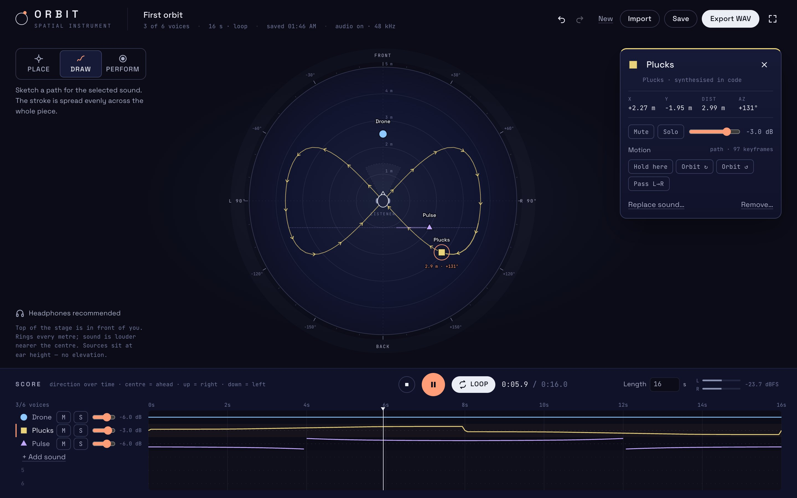
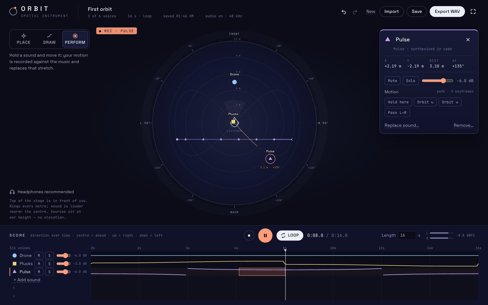
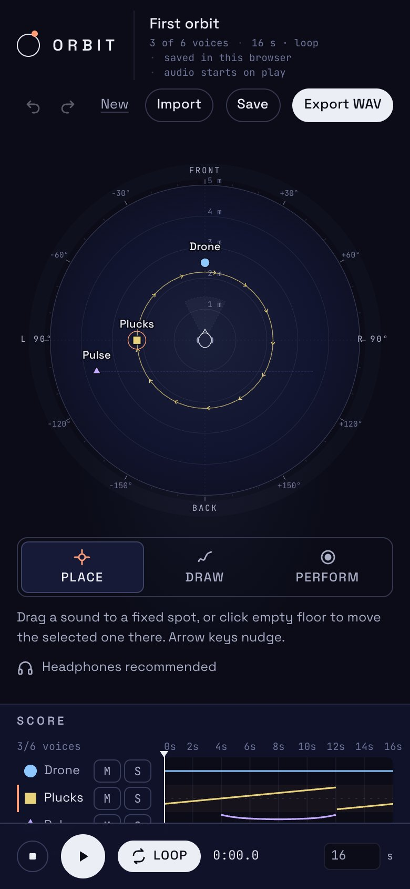

# Orbit — Spatial Sound Theatre

**Conduct a small ensemble of sounds around a listener.** Place, draw or perform where each sound is; those positions drive real Web Audio HRTF panning, a score below shows where every sound is heading over time, and the arrangement renders offline to a WAV that pans the way playback did.



**Live:** https://mariaareadne1.github.io/orbit/ · headphones recommended · MIT

## What it does

- **One stage.** A top-down room in metres: the listener at the centre facing the top, rings every metre to 5 m, an azimuth scale every 10°. Up to six sounds, each with a colour *and* a shape (circle, square, triangle, diamond, hexagon, cross): three generated in code (drone, plucks, pulse) or your own files (WAV/MP3/M4A/OGG/FLAC, decoded locally, mixed to mono, never uploaded).
- **Three gestures.** *Place* (P) drags a sound to a fixed spot — or click empty floor to send the selected one there; arrow keys nudge. *Draw* (D) sketches a path spread evenly across the piece, with direction chevrons on the stage. *Perform* (R) records your hand against the playing music; the stage shows **● Rec** and the score highlights the stretch being replaced. A click without movement records nothing and hands the sound back to its path.
- **A card per sound.** Pick a sound (stage, its name in the score, or keys 1–6) to open its card: origin, live x / y / distance / azimuth, level, mute, solo, motion presets (Hold here, orbits, a pass), replace sound, and a two-step remove.
- **The score.** Six lanes plot each sound's direction over time (centre = ahead, up = right, down = left) under a playhead you can drag or move with arrow keys; empty lanes add sounds. Transport: play/pause, stop, loop, length (4–180 s, typed values explained if invalid), and an output meter read from AnalyserNodes on the live master — it shows nothing when nothing plays.
- **Kept and exported.** Undo/redo (held arrow keys are one step), autosave plus an explicit Save with status, imported audio in IndexedDB (orphans cleaned at load), storage-full and blocked-audio states you can recover from. **Export WAV** renders the same graph offline at 48 kHz, 16-bit stereo, and reports peak, clipped samples and any sound skipped for missing audio.





Before/after and the two composition studies that led here: `docs/media/before/`, `docs/media/studies/` (see DECISIONS.md D6–D8).

## How it stays honest

Positions are scheduled on each `PannerNode`'s AudioParams ahead of time with `linearRampToValueAtTime`, so motion is sample-accurate and independent of the frame rate; the stage only *reads* the same interpolation to draw. Loops are scheduled a quarter-second before each cycle ends. Live playback runs at 48 kHz like the export because browser HRTF kernels depend on the sample rate — before that change, live and exported panning differed by about 0.4 dB.

**Live vs export, measured:** a test taps the live master output with an AudioWorklet during real-time playback of a left-to-right pass, renders the same arrangement offline, and compares left/right balance in half-second windows: the largest difference is **0.04–0.06 dB** in Chromium and **0.05 dB** in WebKit (2026-10-25/26). A second test compares consecutive loop cycles the same way (**0.02–0.06 dB**): loops stay phase-aligned. The stage and score draw from the same interpolation the panners are scheduled with; a test places a sound mid-playback and reads the PannerNode's position back.

> The sections below document the DSP proof the editor is built on.

## Conventions

The listener sits at the origin facing −Z with +Y up, so +X is to the right and −Z straight ahead (Web Audio's right-handed space). The stage is a top-down view in metres: `x` right, `y` forward (up on screen); stage `(x, y)` maps to audio `(x, 0, −y)`. Azimuth is 0° ahead, +90° right, 180° behind. Sources stay at ear height. All of this lives in [`src/audio/coords.ts`](src/audio/coords.ts) and is unit-tested.

Panner: `HRTF`, `inverse` distance model, reference distance 1 m, rolloff 1, omnidirectional cones. Paths are piecewise-linear keyframes scheduled with `linearRampToValueAtTime`; the stage draws positions from the same interpolation function.

## The proof

`src/audio/proof.ts` renders licence-free signals generated in code (seeded pink noise) through the same graph as playback, in an `OfflineAudioContext` at 48 kHz, and measures the output. Measured on 2026-10-21 (Playwright's Chromium 156 and WebKit 27.2 on macOS):

| Measurement | Chromium | WebKit | What it shows |
| --- | --- | --- | --- |
| Sweep (−4, 1) → (4, 1) m over 6 s: mean L/R balance, first / middle / last third | −4.6 / −0.1 / +4.8 dB | −5.3 / −0.1 / +5.4 dB | Moving the source moves the image; the centre crossing lands at 3.03 s / 3.02 s |
| Hard left / right at 2 m, broadband | −4.4 / +4.4 dB | −5.3 / +5.3 dB | Pink noise is low-frequency heavy, where level differences between ears are small |
| Hard left / right, above 2 kHz | −15.1 / +14.7 dB | −17.0 / +17.1 dB | Head shadowing at high frequencies, as HRTF should produce |
| 1 m vs 4 m straight ahead | −12.04 dB | −12.04 dB | Matches the inverse distance model (−12.04 dB) |
| Full orbit at 2 m: balance at ¼ and ¾ turn | +4.6 / −4.6 dB | +5.2 / −5.1 dB | Right then left, as the path says |
| Ahead vs behind at 2 m, share of energy above 4 kHz | −10.4 vs −13.4 dB | −10.0 vs −13.3 dB | Behind is darker in both engines — reported, not claimed as convincing front/back localisation |
| Peak / clipped samples | 0.40 / 0 | — / 0 | No clipping |

The sweep is also encoded to 16-bit WAV in the page and checked outside the browser: Python's `wave` module reads 2 channels, 48 kHz, 6.000 s, first-second balance −4.79 dB, last-second +4.83 dB; `ffprobe` reports `pcm_s16le`, 48000 Hz, 2 channels, 6.000 s.

**Limits, plainly:** browser HRTF datasets differ by engine and are not personalised, so front/back and elevation cues are weak for many listeners; spatial effects need headphones; nothing here promises "8D" immersion. Firefox was not tested.

## Run

```bash
pnpm install
pnpm test        # unit: coordinates, paths, gestures, analysis, WAV
pnpm test:e2e    # browser, Chromium + WebKit (36 per engine, 2 file checks run once): proof, DSP fixtures (sine/noise L/R,
                 # circle, distance) decoded by python `wave` + ffprobe, live vs export parity, loop
                 # phase, panner read-back, gestures, keyboard, storage-full, GC, blocked audio, phone
ORBIT_FAKE_AUDIO=1 pnpm test:e2e --project=chromium   # when the machine's audio output clock is stuck
node scripts/screenshots.mjs   # README screenshots (needs pnpm dev)
pnpm dev         # http://localhost:5431
```

A representative export, `docs/media/samples/orbit-circle-pink-noise.wav` (4 s pink noise circling clockwise at 2 m): python `wave` reads 2 ch / 48 kHz / 16-bit / 4.000 s, first second +3.3 dB (right), last second −3.5 dB (left); ffprobe `pcm_s16le`.
